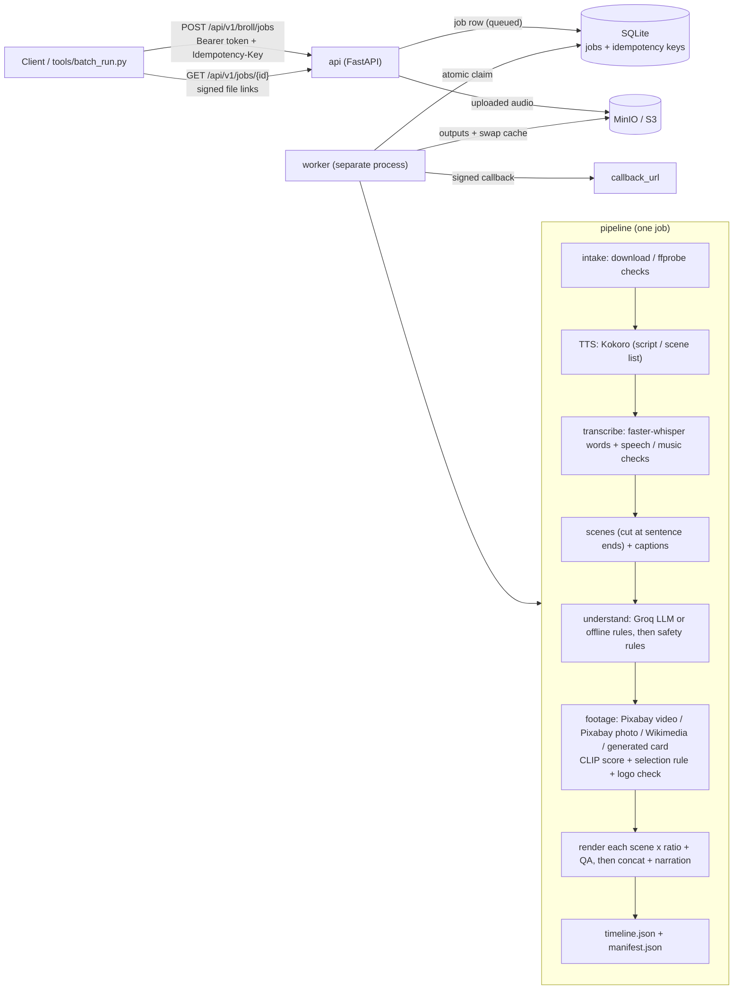

# B-roll Engine (IncuBrix Assessment 3)

Give it a narration, get back B-roll videos that match what is being said.

**Input** (one of):
- a voiceover file (mp3 / wav / m4a, up to 10 minutes) as an **upload** or an **`audio_url`**,
- a plain **`script`** (the voice is made with Kokoro TTS),
- an IncuBrix **scene list** `[{"text", "visual_hint"}]` (one scene per item; `visual_hint` is always searched first).

**Output** per job, stored in MinIO / S3 and returned as signed download links:
`video_16x9.mp4`, `video_9x16.mp4`, `video_1x1.mp4` (H.264 + AAC 48 kHz, 30 fps, yuv420p, 1080p-class),
`captions.srt`, `timeline.json` (every scene: text, times, search queries, chosen clip, licence, score and
the *reason* it was chosen) and `manifest.json` (models + versions, settings, seed, stage timings, cost
estimate, warnings, licences, ai_generated flags, QA results), plus one small 16:9 JPEG poster frame per
scene (`thumb_000.jpg`, ..., named in `timeline.json` as each scene's `thumbnail`).

After a job, any scene's clip can be **swapped** (next best, a named clip, or a URL); only that scene is
re-rendered.

A web UI, the **B-roll Studio**, is served at `http://localhost:8000/` (see [B-roll Studio](#b-roll-studio-web-ui)).

## How it works



- **api** and **worker** are separate processes sharing one SQLite file. The API only validates and queues
  (`202 + job_id`); the worker claims queued jobs with an atomic `UPDATE ... WHERE status='queued'`, so two
  workers never take the same job.
- **Selection rule** (stored per scene in `timeline.json` as `reason`): the best stock candidate whose CLIP score
  is `>= STOCK_MIN_SCORE` and that is not used yet in this video, trying sources in `PROVIDER_ORDER` (a stock
  video beats photo-motion unless the photo is clearly better); a statistic line gets the same footage with its
  number drawn as a badge (`STATISTIC_OVERLAY`); a near miss is used only if the independent vision judge agrees;
  then the best usable clip with a keyword badge; a plain `generated` card only when no footage is usable. A
  provider error never fails the job (warning + next source); a corrupted download is skipped. `QUALITY_MODE`
  (`fast` / `balanced` / `best`) sets how many candidates are scored.
- **Card text comes only from the narration** (`app/pipeline/cards.py`): code reads every figure in the scene's
  own words (`40%`, `40 percent`, `forty percent`, `$1.2 million` -> `$1.2M`, `Rs 500`, `3x`, `2025`), shows the
  main one (a percentage or money before a year) and a short phrase from the same sentence. An LLM suggestion is
  dropped with a warning if it holds any number the narration does not say. No count-up animation (it used to
  show in-between numbers like `21%`). `timeline.json` records `card_text`, `card_subtitle`, `card_source`
  (`narration`) and `card_numbers` per scene.
- **Footage speed** (same choices): pass 1 searches + scores `FOOTAGE_WORKERS` scenes at the same time (queries
  in parallel, previews over one pooled connection, CLIP in batches, logo check only until the winner is certain);
  pass 2 picks one clip per scene in scene order, so the no-repeat rule is unchanged. Searches and previews are
  cached per job and for `FOOTAGE_CACHE_SECONDS` across jobs; the worker loads CLIP once at start.
- **Logo check**: every passing candidate's thumbnail AND `LOGO_FRAME_COUNT` frames of the downloaded clip get
  a calibrated *logo probability* (CLIP softmax, logo prompts vs. matched neutral prompts, whole picture + 3x3
  crops); above `LOGO_REJECT_PROB` the clip is rejected (recorded as `logo_check` in `timeline.json`). Measured
  precision / recall on hand-labelled Pixabay thumbnails, including where it fails:
  [testpack/calibration/logo_report.md](testpack/calibration/logo_report.md).
- **Footage mix**: `manifest.json` → `footage_mix` counts how many scenes use stock video, photo-motion and
  generated cards (with shares of all scenes and of the non-statistic scenes).
- **Clip swap**: the full job saves a *swap cache* (narration, every rendered segment, scenes, captions,
  saved understanding, chosen clips). A swap downloads it, picks the new clip, renders **only that scene** for
  each ratio, joins all segments again with stream copy, re-runs QA and writes new `timeline.json` /
  `manifest.json` with a `swaps` history (swap time next to the full render time).

## Quick start

```powershell
Copy-Item .env.example .env                 # every setting is listed there; the defaults use mock adapters
docker compose up --build                   # API + worker + MinIO, then open http://localhost:8000/
docker compose run --rm api pytest          # all tests, no API keys
```

Real mode needs these names in `.env` (values never go in the repository): `GROQ_API_KEY`, `PIXABAY_API_KEY`,
`WIKIMEDIA_USER_AGENT` (a contact e-mail / URL), `API_TOKENS`, `FILE_LINK_SECRET`, `CALLBACK_SECRET`; optional:
`VLM_PROVIDER=groq` (vision judge), `QUALITY_MODE`. More: [REPORT.md](REPORT.md) (what was built and measured),
[SOURCES.md](SOURCES.md) (licences), [testpack/INDEX.md](testpack/INDEX.md) (evidence for every form row).

## Setup

You need **FFmpeg** (and for the Docker path, Docker Desktop). All tests and the default settings use mock
adapters: **no API keys are needed**.

### Docker (all services: api, worker, minio, minio-init)

```powershell
git clone <repo-url> broll-engine
cd broll-engine
Copy-Item .env.example .env
docker compose up --build
```

API docs: http://localhost:8000/docs - MinIO console: http://localhost:9001 (minioadmin / minioadmin).

### Windows without Docker (local `.venv`, files in `./data/storage`)

```powershell
git clone <repo-url> broll-engine
cd broll-engine
py -3.11 -m venv .venv
.venv\Scripts\python -m pip install -r requirements.txt
.venv\Scripts\python -m pip install --index-url https://download.pytorch.org/whl/cpu torch==2.14.1 torchvision==0.29.1
.venv\Scripts\python -m pip install -r requirements-ml.txt
.\scripts\run_api.ps1        # window 1 (creates .env from .env.example the first time)
.\scripts\run_worker.ps1     # window 2
```

The torch / ML lines are only needed for the real models (Kokoro, Whisper, CLIP); with the default mock
settings the other commands are enough.

**Real mode**: in `.env` set `TTS_PROVIDER=kokoro`, `TRANSCRIBE_PROVIDER=whisper`, `UNDERSTAND_PROVIDER=groq`
+ `GROQ_API_KEY`, `PIXABAY_API_KEY`, `PROVIDER_ORDER=pixabay_video,pixabay_image_motion,wikimedia,generated`,
`RANK_SCORER=clip` and a `WIKIMEDIA_USER_AGENT` with your contact. Keys go in `.env` only (git-ignored).

## Using the API

Every `/api/v1` call needs `Authorization: Bearer <token>` (`API_TOKENS`; `dev-token` in `.env.example`).
The full contract is [openapi.yaml](openapi.yaml) (OpenAPI 3.1).

| Method + path | What it does |
|---|---|
| `GET /health` | process alive |
| `GET /ready` | database + storage reachable (503 `NOT_READY` otherwise) |
| `POST /api/v1/broll/jobs` | start a job: JSON (`audio_url` / `script` / `scenes` + options) or multipart (`audio` file + `options` JSON) -> `202 {job_id}` |
| `GET /api/v1/jobs/{job_id}` | `status` (queued / running / succeeded / failed), `progress` 0-100, `stage`, `warnings`, `error`, `result.files` (signed links) |
| `POST /api/v1/broll/jobs/{job_id}/scenes/{scene_index}/swap` | swap one scene's clip (background job, `Idempotency-Key` required) -> `202 {job_id}` |
| `GET /api/v1/jobs/{job_id}/files/{filename}?expires=&sig=` | download a result file (the signed link from `result.files`; no token needed). Supports one `Range: bytes=a-b` (206 Partial Content, `Accept-Ranges: bytes`), so videos seek at once |
| `GET /api/v1/jobs?limit=20` | the caller's own jobs, newest first (id, status, input type, created, processing seconds, error code) |
| `GET /api/v1/config/public` | safe settings for a UI: voices, aspect ratios, max audio seconds, max upload MB (no secrets) |

Headers: `Idempotency-Key` on every POST (same key + same body = same job; same key + different body = 409),
`X-Correlation-Id` (echoed back and written into every log line of the request and its job). With
`callback_url`, the finished job is POSTed there with `X-IncuBrix-Signature` = hex HMAC-SHA256(raw body,
`CALLBACK_SECRET`).

```powershell
$h = @{ Authorization = "Bearer dev-token"; "Idempotency-Key" = "demo-1" }
$job = Invoke-RestMethod -Method Post http://localhost:8000/api/v1/broll/jobs -Headers $h -ContentType "application/json" `
  -Body '{"script": "Saving money is not about earning more. It is about spending wisely.", "aspect_ratios": ["16:9", "9:16"]}'
Invoke-RestMethod http://localhost:8000/api/v1/jobs/$($job.job_id) -Headers @{ Authorization = "Bearer dev-token" }
```

### Swapping a clip

Body (exactly one way to choose; an empty body means `next_best`):

```json
{"mode": "next_best"}
{"provider": "pixabay_video", "clip_id": "123456"}
{"clip_url": "https://cdn.pixabay.com/video/2024/01/02/123456-789_medium.mp4"}
{"clip_url": "https://example.com/my.mp4", "user_supplied": true, "licence": "CC0",
 "licence_url": "https://creativecommons.org/publicdomain/zero/1.0/", "attribution": "Me", "commercial_use": true}
```

- `next_best` = the normal selection rule again, with every clip ever used in this video excluded.
- `clip_url` is downloaded through the SSRF-safe downloader. Pixabay addresses get the Pixabay licence;
  Wikimedia files are looked up and must pass the CC0 / Public Domain / CC BY filter; any other public address
  needs `user_supplied: true` and all licence fields.
- A clip already in the video is refused (`INVALID_INPUT`, `details.reason = clip_already_used`); a chosen
  clip whose frames show a logo is refused (`details.reason = logo_check_failed`).
- The swap job's `result.files` hold the new versions; the original job's files are not changed. Swapping
  again (with the original or the swap job id) builds on the latest version; one swap per video at a time
  (a second swap while one is queued / running gets 409 `SWAP_IN_PROGRESS`).

## B-roll Studio (web UI)

Start the API (and the worker), then open **http://localhost:8000/** and paste an API token (from
`API_TOKENS`) in the top bar. Plain HTML + CSS + JavaScript in [app/studio/](app/studio/), served by FastAPI
(`GET /` and `/studio/<file>`); no build step, no CDN. `STUDIO_ENABLED=false` switches it off. It only uses
the public API above, so everything it shows comes from the job, `timeline.json` and `manifest.json`.

- **Create**: Voiceover (drag and drop / choose a file, or an audio URL), Script (word count + estimated length,
  voice) or Scene list (rows of text + visual hint); aspect ratios, style, avoid tags, burned-in captions;
  one-click examples for the hard cases (double meanings, statistics, sad news, named brand, scene hints).
  API errors are shown with their code.
- **Progress**: stage stepper, progress bar, elapsed time, warnings. Polls with a growing pause and waits
  `Retry-After` on a 429.
- **Result**: player with one tab per ratio (9:16 in a phone frame; it streams the signed link with HTTP
  Range requests, so it starts and seeks at once), downloads, and a scene strip: poster frame,
  times, text, provider + clip type, licence link, attribution, AI-generated / Generated badges, relevance bar
  (with the `STOCK_MIN_SCORE` mark), logo-check result and the selection reason. Clicking a scene seeks the
  player; the playing scene is highlighted. **Swap clip** runs a `next_best` swap for that scene and shows the
  swap time next to the full render time.
- **Recent jobs** (your token's jobs) and **Insights**: footage mix, stage timings chart, cost estimate, models.
- The page sends `Referrer-Policy: no-referrer` (signed links never leak) and a strict Content-Security-Policy.
- Optional browser test: `pip install playwright` + `python -m playwright install chromium`, then
  `tests/e2e/test_studio_browser.py` runs (it is skipped without Playwright).

## Live demo

**URL:** `https://<workspace>--broll-studio.modal.run` *(placeholder; the real link is in the Submission Form)*

- **Access:** open the URL and paste the API token from the **Submission Form** into the Studio's top bar. For the
  API, send `Authorization: Bearer <token>` (`/health` and `/ready` need no token). No token is in this repository;
  the demo reads `API_TOKENS`, `FILE_LINK_SECRET`, `CALLBACK_SECRET`, `PIXABAY_API_KEY`, `GROQ_API_KEY` and
  `WIKIMEDIA_USER_AGENT` from the Modal secret `broll-secrets` and refuses to start without the first three.
- **Where it runs:** [Modal](https://modal.com), [deploy/modal/modal_app.py](deploy/modal/modal_app.py). ONE container
  (`max_containers=1`, 2 CPU cores, 5 GiB memory request / 8 GiB limit, sized from the measured peak of 4.4 GB with
  one render worker) runs the API and the worker as a background thread (`WORKER_CONCURRENCY=1`,
  `FOOTAGE_WORKERS=2`, `RENDER_WORKERS=1`, `QUALITY_MODE=balanced`). Real adapters: Kokoro, faster-whisper small,
  Groq (+ the optional vision judge when `VLM_PROVIDER` is set), Pixabay video / photo, Wikimedia, Openverse,
  generated cards, CLIP.
- **Cold start:** it scales to zero (`min_containers=0`): with no traffic there is no container and no cost. The first
  request after a quiet time waits until a container has started (the request is held open, about a minute is
  expected; measure it with `tools/live_check.py --cold`). All models are baked into the image at build time and
  `HF_HUB_OFFLINE=1` is set, so a cold start downloads nothing. A container stays up 180 s after the last request
  (`MODAL_SCALEDOWN_SECONDS`). While a job runs, the Studio, `tools/batch_run.py` and `tools/live_check.py` keep
  polling it, and every poll keeps the container up. If a container still stops mid-job, the job is queued again
  when the next container starts (see "Jobs are never silently lost" below).
- **Cost guards** (the account has about $1/month of credit; estimate in
  [testpack/notes/cost_modal.md](testpack/notes/cost_modal.md)): at most `DEMO_MAX_JOBS_PER_DAY=20` and
  `DEMO_MAX_JOBS_PER_MONTH=50` new jobs + swaps for all tokens together (then `429 DAILY_LIMIT_REACHED` with
  `Retry-After` until midnight UTC, or `429 MONTHLY_LIMIT_REACHED` with `Retry-After` until the 1st of next month
  UTC; both retryable); narration at most 600 s (`DEMO_MAX_AUDIO_SECONDS` -> `MAX_AUDIO_SECONDS`, the product
  limit of 10 min; the Modal function timeout is 3 h); `RATE_LIMIT_POST_PER_MINUTE=4` and `RATE_LIMIT_GET_PER_MINUTE=300` per token. All are
  deploy-time knobs (see the top of `modal_app.py`). Estimate (not measured on Modal): one cold visit with one
  short job is about $0.012, so 50 short jobs in 50 separate visits is about $0.58 of the $1 monthly credit. The
  caps count jobs, not minutes: a 10-minute narration is estimated at about $0.18, so many long jobs would use
  the credit up sooner (see section 9 of the cost notes).
- **Storage (differs from docker compose):** on Modal the SQLite database and the output files live on the Modal
  Volume `broll-data` (`STORAGE_BACKEND=local`, `/data`), with `SQLITE_JOURNAL_MODE=DELETE`. docker compose keeps
  MinIO (S3) as required by the brief; the API, signed links and Range downloads behave the same. The Volume is
  committed after every job and at shutdown, so jobs and files survive scale-down. Temp files and the footage cache
  are on the container's own disk and are lost on scale-down. Links expire after `FILE_LINK_TTL_SECONDS`.
- **Jobs are never silently lost:** when a container starts, jobs a previous container left `running` (it was
  stopped mid-job) are queued once more (with a warning); if that happens a second time they fail with
  `JOB_INTERRUPTED` (retryable). Safe only because there is exactly one container.
- **Deploy:** `.venv\Scripts\modal deploy deploy/modal/modal_app.py` (the URL is printed at the end and shown in
  the Modal dashboard). Check from outside: `python tools/live_check.py --url <modal-url> --cold`.
- **Fallback (no account needed):** `.\scripts	unnel.ps1` starts the API + worker on this PC and a Cloudflare quick
  tunnel (cloudflared is downloaded on demand into the git-ignored `toolsin\`, and its code signature is checked),
  then prints a public `https://<words>.trycloudflare.com` URL. It refuses `dev-token` (set a long random
  `API_TOKENS` in `.env` first), uses the same cost guards, and lives only while the window is open.
- **Models:** the Modal image runs `deploy/modal/preload_models.py` offline at build time to check that every model
  loads, so a cold start downloads nothing.

## Tests

One command runs all unit + integration + e2e tests with mock adapters (no API keys, no models):

```powershell
docker compose run --rm api pytest     # Docker (also runs the MinIO test)
.\scripts\test.ps1                      # Windows .venv (the MinIO test is skipped)
.\scripts\test.ps1 -k swap              # any pytest option works
```

`tests/unit/test_openapi_contract.py` fails if a route, method, header, request field, job field or error code
differs between the app and `openapi.yaml`; `tests/unit/test_docs_in_sync.py` does the same for this README,
`.env.example` and `CLAUDE.md`.

## Batch runner

```powershell
.venv\Scripts\python tools\batch_run.py testpack\inputs --out testpack\outputs\run1
.venv\Scripts\python tools\batch_run.py inputs.jsonl --out out --api https://<live-url> --token <token> --ratios 16:9,9:16 --concurrency 3
```

- Input: a folder of audio files (uploaded), `.txt` scripts and `.json` request bodies, or a `.jsonl` file
  (one body per line). `"name"` in a body names its output folder.
- Each input is sent with an Idempotency-Key made from the input itself (re-running never duplicates work),
  polled until it ends, and every output file is downloaded into `--out/<input-name>/` with `job.json`.
- `--out/summary.csv` and `summary.md`: input, job_id, status, error code, narration seconds, turnaround
  seconds, scenes, warnings count.
- Options: `--api` (default `$BROLL_API_URL` or http://localhost:8000), `--token` (default `$BROLL_API_TOKEN`
  or `dev-token`), `--ratios`, `--keep-input-ratios` (a .json input with its own `aspect_ratios` keeps them),
  `--concurrency` (default 2), `--timeout`, `--poll`.

## Settings

Every setting comes from an environment variable or `.env` ([app/config.py](app/config.py)); all are listed with
comments in [.env.example](.env.example). "Code default" is used when the variable is not set at all.

| Setting | Code default | `.env.example` | What it does |
|---|---|---|---|
| **General** | | | |
| `APP_NAME` | `broll-engine` | `broll-engine` | App name shown in logs. |
| `APP_VERSION` | `0.2.0` | `0.2.0` | App version reported in logs / docs. |
| `LOG_LEVEL` | `INFO` | `INFO` | DEBUG, INFO, WARNING or ERROR. |
| `PUBLIC_BASE_URL` | *(empty)* | `http://localhost:8000` | Public address of the API, used in links inside callbacks. Empty = use the request's own address. |
| **Auth + rate limit** | | | |
| `API_TOKENS` | *(empty)* | `dev-token` | Comma-separated bearer tokens allowed to call /api/v1. EMPTY = auth OFF (local dev only!). |
| `RATE_LIMIT_POST_PER_MINUTE` | `30` | `30` | Max POST requests (new jobs + clip swaps) per token per minute (0 = no limit). Over the limit -&gt; 429 RATE_LIMITED with a `Retry-After` header (seconds to wait). |
| `RATE_LIMIT_GET_PER_MINUTE` | `600` | `600` | Max GET requests (job status + file downloads) per token per minute (0 = no limit). Same 429 rule. File downloads count against the job owner's GET limit. |
| `JOBS_LIST_MAX` | `100` | `100` | Most jobs `GET /api/v1/jobs` may return in one answer (`?limit=1..this`). |
| `DEMO_MAX_JOBS_PER_DAY` | `0` | `0` | Cost guard for a paid live demo: at most this many NEW jobs (incl. clip swaps) per UTC day, all tokens together; then 429 DAILY_LIMIT_REACHED until midnight UTC. An idempotent replay is still answered. 0 = no cap (the Modal demo uses 12). |
| `DEMO_MAX_JOBS_PER_MONTH` | `0` | `0` | Same cost guard per UTC calendar month; then 429 MONTHLY_LIMIT_REACHED until the 1st of next month (UTC). 0 = no cap (the Modal demo uses 50). |
| **Studio (web UI)** | | | |
| `STUDIO_ENABLED` | `true` | `true` | true = serve the B-roll Studio web page at `GET /` (its files under `/studio/`). false = API only. |
| `STUDIO_DIR` | *(empty)* | *(empty)* | Folder with the Studio files. Empty = `app/studio` next to the code. |
| `STUDIO_FRAME_ANCESTORS` | *(empty)* | *(empty)* | Sites allowed to show the Studio in a frame (CSP `frame-ancestors`), space-separated, e.g. `https://huggingface.co`. Empty = none. |
| **Database** | | | |
| `DATABASE_URL` | `sqlite:///./data/broll.db` | `sqlite:///./data/broll.db` | SQLite file for jobs + idempotency keys. (Docker overrides this to /app/data/broll.db.) |
| `SQLITE_JOURNAL_MODE` | `WAL` | `WAL` | `WAL` (readers + a writer at once; needs a normal local disk) or `DELETE` (plain journal file; used on the Modal Volume). |
| **Storage** | | | |
| `STORAGE_BACKEND` | `local` | `local` | "local" = save files in LOCAL_STORAGE_DIR (my PC). "s3" = MinIO / S3 (Docker, CI, deployment). |
| `LOCAL_STORAGE_DIR` | `./data/storage` | `./data/storage` | Folder used when STORAGE_BACKEND=local. |
| `S3_ENDPOINT_URL` | `http://localhost:9000` | `http://localhost:9000` | MinIO / S3 address (Docker overrides this to http://minio:9000). |
| `S3_ACCESS_KEY` | `minioadmin` | `minioadmin` | MinIO / S3 access key (also the MinIO admin user in docker compose). |
| `S3_SECRET_KEY` | `minioadmin` | `minioadmin` | MinIO / S3 secret key (also the MinIO admin password in docker compose). |
| `S3_BUCKET` | `broll` | `broll` | Bucket that holds all job files. |
| `S3_REGION` | `us-east-1` | `us-east-1` | S3 region (MinIO ignores it, but boto3 needs one). |
| **Signed download links** | | | |
| `FILE_LINK_SECRET` | `change-me-file-link-secret` | `change-me-file-link-secret` | Secret used to sign download links. CHANGE THIS in any shared deployment. |
| `FILE_LINK_TTL_SECONDS` | `3600` | `3600` | How long a download link works, in seconds. |
| **Uploads** | | | |
| `MAX_UPLOAD_MB` | `100` | `100` | Largest upload accepted, in MB. Bigger -&gt; 413 FILE_TOO_LARGE. |
| `ALLOWED_AUDIO_EXTENSIONS` | `mp3,wav,m4a` | `mp3,wav,m4a` | File extensions accepted for the "audio" upload field. |
| `WORK_DIR` | `./data/work` | `./data/work` | Folder for temporary files while working. |
| **Callbacks** | | | |
| `CALLBACK_SECRET` | `change-me-callback-secret` | `change-me-callback-secret` | Secret for X-IncuBrix-Signature = hex HMAC-SHA256(raw body, CALLBACK_SECRET). CHANGE THIS. |
| `CALLBACK_MAX_RETRIES` | `3` | `3` | Retries after the first failed callback attempt. |
| `CALLBACK_BACKOFF_SECONDS` | `1.0` | `1.0` | First wait between retries in seconds; it doubles each time (1, 2, 4 ...). |
| `CALLBACK_TIMEOUT_SECONDS` | `10.0` | `10.0` | How long to wait for the receiver to answer, in seconds. |
| **Worker** | | | |
| `WORKER_CONCURRENCY` | `2` | `2` | How many jobs one worker process runs at the same time. |
| `WORKER_POLL_SECONDS` | `1.0` | `1.0` | How often an idle worker checks for new jobs, in seconds. |
| `KEEP_WORK_FILES` | `false` | `false` | true = keep each job's temp folder (WORK_DIR/&lt;job_id&gt;) after the job, for debugging. |
| **FFmpeg** | | | |
| `FFMPEG_BIN` | `ffmpeg` | `ffmpeg` | Name or full path of the ffmpeg / ffprobe programs. |
| `FFPROBE_BIN` | `ffprobe` | `ffprobe` | Name or full path of the ffmpeg / ffprobe programs. |
| `FFMPEG_TIMEOUT_SECONDS` | `600.0` | `600` | Longest time one ffmpeg call may run, in seconds. |
| **Intake (input checks)** | | | |
| `MAX_AUDIO_SECONDS` | `600.0` | `600` | Longest narration accepted, in seconds. Longer -&gt; FILE_TOO_LONG. |
| `MAX_DOWNLOAD_MB` | `100` | `100` | Largest audio_url download, in MB. Bigger -&gt; FILE_TOO_LARGE. |
| `DOWNLOAD_TIMEOUT_SECONDS` | `60.0` | `60` | Total time allowed for downloading audio_url, in seconds. Slower -&gt; DOWNLOAD_FAILED. |
| `AUDIO_SAMPLE_RATE` | `48000` | `48000` | All audio is converted to mono WAV at this sample rate (Hz). |
| **Text to speech** | | | |
| `TTS_PROVIDER` | `mock` | `mock` | "kokoro" (real voice, Kokoro-82M, Apache-2.0) or "mock" (a plain tone; tests / CI). |
| `KOKORO_REPO_ID` | `hexgrad/Kokoro-82M` | `hexgrad/Kokoro-82M` | Hugging Face model id for Kokoro. |
| `KOKORO_SPEED` | `1.0` | `1.0` | Speaking speed for Kokoro (1.0 = normal). |
| `TTS_VOICE_MAP` | `en-US-female=a:af_heart,en-US-male=a:am_michael,en-GB-fem...` | `en-US-female=a:af_heart,en-US-male=a:am_michael,en-GB-fem...` | Our voice names -&gt; kokoro "language code:voice id". en-IN uses a Hindi speaker voice reading English. |
| `SCENE_PAUSE_SECONDS` | `0.3` | `0.3` | Scene-list input: seconds of silence after each scene's narration. |
| `TTS_CACHE_DIR` | `./data/tts_cache` | `./data/tts_cache` | Finished TTS audio is reused for the same text + voice + model + speed. Empty = off. |
| `MOCK_WORDS_PER_SECOND` | `2.5` | `2.5` | Mock TTS: words per second (sets the length of its tone). |
| **Transcription** | | | |
| `TRANSCRIBE_PROVIDER` | `mock` | `mock` | "whisper" (faster-whisper, MIT) or "mock" (spreads the known text evenly; tests / CI). |
| `WHISPER_MODEL` | `small` | `small` | Whisper model size: tiny, base, small, medium ... |
| `WHISPER_DEVICE` | `cpu` | `cpu` | cpu or cuda. |
| `WHISPER_COMPUTE_TYPE` | `int8` | `int8` | int8 = small and fast on a CPU. |
| `WHISPER_BEAM_SIZE` | `5` | `5` | Beam search width (higher = a bit more accurate, slower). |
| `WHISPER_LANGUAGE` | *(empty)* | *(empty)* | Language code like "en" or "hi". Empty = detect automatically. |
| `TRANSLATE_FOR_SEARCH` | `true` | `true` | Non-English narration: Whisper also translates the speech to English, used ONLY for footage search queries; captions stay in the spoken language. |
| `WHISPER_VAD_FILTER` | `true` | `true` | true = skip parts with no voice (helps with music); timestamps stay correct. |
| `MOCK_TRANSCRIPT` | `This is a mock transcript. The mock adapter does not list...` | `This is a mock transcript. The mock adapter does not list...` | Mock transcriber: text used for uploaded audio (it cannot really listen). |
| **Speech checks** | | | |
| `SILENCE_MAX_VOLUME_DB` | `-45.0` | `-45` | Loudest moment below this (dB) = silent file -&gt; NO_SPEECH_DETECTED. |
| `SILENCE_NOISE_DB` | `-45.0` | `-45` | Quieter than this (dB) for at least SILENCE_MIN_SECONDS counts as silence. |
| `SILENCE_MIN_SECONDS` | `0.5` | `0.5` | Quieter than this (dB) for at least SILENCE_MIN_SECONDS counts as silence. |
| `MIN_SOUND_SECONDS` | `0.5` | `0.5` | Less non-silent audio than this (seconds) -&gt; NO_SPEECH_DETECTED. |
| `MUSIC_MIN_WORDS_PER_MINUTE` | `20.0` | `20` | Fewer recognised words per minute of sound than this -&gt; MUSIC_ONLY_AUDIO. |
| `MUSIC_MAX_NO_SPEECH_PROB` | `0.6` | `0.6` | Whisper's average "no speech" probability above this -&gt; MUSIC_ONLY_AUDIO. |
| `MUSIC_MIN_WORD_PROB` | `0.3` | `0.3` | Average word confidence below this -&gt; MUSIC_ONLY_AUDIO. |
| **Scenes** | | | |
| `MIN_SCENE_SECONDS` | `2.0` | `2.0` | Shorter scenes are merged with a neighbour; longer ones are split. |
| `MAX_SCENE_SECONDS` | `8.0` | `8.0` | Shorter scenes are merged with a neighbour; longer ones are split. |
| `PAUSE_SECONDS` | `0.35` | `0.35` | A gap between two words at least this long (seconds) counts as a phrase pause. |
| **Captions** | | | |
| `CAPTION_MAX_CHARS_PER_LINE` | `42` | `42` | Max characters per caption line and max lines per caption. |
| `CAPTION_MAX_LINES` | `2` | `2` | Max characters per caption line and max lines per caption. |
| `CAPTION_MAX_SECONDS` | `6.0` | `6.0` | Longest time one caption stays on screen, in seconds. |
| `CAPTION_LINGER_SECONDS` | `0.4` | `0.4` | Keep a caption up this long after its last word, in seconds. |
| `CAPTION_FONT` | `Arial` | `Arial` | Font for burned-in captions (falls back to a similar font if missing). |
| `CAPTION_FONTS_BY_LANGUAGE` | `ta=Noto Sans Tamil,hi=Noto Sans Devanagari,mr=Noto Sans Devanagari,ne=Noto Sans Devanagari` | same | Caption language (Whisper code) -&gt; font. Text with Tamil / Devanagari letters gets that font even without a language code. Fonts ship in `app/fonts` (SIL OFL). |
| `CAPTION_FONT_SCALES` | `Noto Sans Devanagari=1.4` | same | Size factor per font so every script looks about as big (Noto Sans Devanagari draws small letters at the same size). |
| `CAPTION_FONTS_DIR` | *(empty = `app/fonts`)* | *(empty)* | Folder of caption font files given to FFmpeg (`fontsdir`). |
| **Render** | | | |
| `RENDER_FPS` | `30` | `30` | Frames per second of every output video. |
| `VIDEO_PRESET` | `veryfast` | `veryfast` | libx264 speed preset (ultrafast ... veryslow) and quality (lower CRF = better, bigger). |
| `VIDEO_CRF` | `23` | `23` | libx264 speed preset (ultrafast ... veryslow) and quality (lower CRF = better, bigger). |
| `AUDIO_BITRATE` | `192k` | `192k` | AAC audio bitrate of the output videos. |
| `RENDER_WORKERS` | `3` | `3` | Scene segments rendered at the same time (each its own ffmpeg). 1 = one after the other. |
| **Reproducibility** | | | |
| `SEED` | `1234` | `1234` | One seed for LLM sampling, mock providers and generated card colours. |
| **Network safety (SSRF)** | | | |
| `ALLOW_PRIVATE_URLS` | `false` | `false` | false = refuse audio_url / footage URLs that point to private, loopback or link-local addresses. Only tests set true (they use local servers). Keep false everywhere else. |
| **Scene understanding** | | | |
| `UNDERSTAND_PROVIDER` | `mock` | `mock` | "groq" (LLM, needs GROQ_API_KEY; falls back to rules + a warning if it fails), "rules" (offline sense dictionary) or "mock" (tests / CI). |
| `GROQ_API_KEY` | *(empty)* | *(empty)* | Groq API key (console.groq.com). Put the real key ONLY in .env. |
| `GROQ_BASE_URL` | `https://api.groq.com/openai/v1` | `https://api.groq.com/openai/v1` | Groq's OpenAI-compatible endpoint. |
| `LLM_MODEL` | `openai/gpt-oss-120b` | `openai/gpt-oss-120b` | Groq model id. gpt-oss is Apache-2.0; any Groq chat model with JSON mode works. |
| `LLM_TIMEOUT_SECONDS` | `30.0` | `30` | Seconds to wait for one LLM answer. |
| `LLM_TEMPERATURE` | `0.0` | `0` | 0 = always the most likely answer, so the same script gives the same queries (repeatable). |
| `LLM_RETRIES` | `1` | `1` | Extra tries after a failed LLM call. |
| `LLM_BATCH_SIZE` | `6` | `6` | Scenes per LLM request (long scripts go in batches; each batch also gets the whole script). |
| `LLM_MAX_RETRY_AFTER_SECONDS` | `30.0` | `30.0` | HTTP 429 from the LLM: wait its retry-after, at most this long per wait. |
| `LLM_MAX_WAIT_SECONDS` | `120.0` | `120.0` | All rate-limit waits of one job together; after that the remaining scenes use the rules. |
| `LLM_REASONING_EFFORT` | `` | `` | gpt-oss reasoning_effort (low / medium / high). Empty = the provider's default. |
| `QUERIES_PER_SCENE` | `5` | `5` | Search queries per scene (meaning, metaphor, setting, action, mood). |
| `QUALITY_MODE` | `balanced` | `balanced` | `fast` / `balanced` / `best`: fills in QUERIES_PER_SCENE, PROVIDER_PAGES, MAX_CANDIDATES_PER_SOURCE, EARLY_EXIT, MULTI_FRAME_TOP_K, VLM_TOP_K, VLM_MAX_SCENES_PER_JOB, VLM_JUDGE_CONFIDENT (see `QUALITY_PRESETS` in app/config.py) unless you set them yourself; `fast` also switches the judge off. Recorded in manifest.json. |
| `STORY_SENSITIVE_MIN_SCENES` | `2` | `2` | The whole story is sensitive (calm rules for EVERY scene) from this many sensitive scenes. |
| `STORY_SENSITIVE_MIN_SHARE` | `0.3` | `0.3` | ...or from this share of sensitive scenes (or when the LLM says so). |
| **Footage providers** | | | |
| `PROVIDER_ORDER` | `pixabay_video,pixabay_image_motion,wikimedia,openverse,generated` | `mock,generated` | Order in which sources are tried for each scene. Real order (my PC): pixabay_video,pixabay_image_motion,wikimedia,openverse,generated Docker / CI default: mock,generated (no keys, no network). Also available: pexels. |
| `PROVIDERS_DISABLED` | *(empty)* | *(empty)* | Comma-separated providers to switch off, e.g. pixabay_video. |
| `PROVIDERS_OVERRIDE_FILE` | `./data/providers_override.json` | `./data/providers_override.json` | JSON file re-read before every search, to switch a provider off DURING a job: {"disabled": ["pixabay_video"]} |
| `PROVIDER_TIMEOUT_SECONDS` | `15.0` | `15` | Seconds to wait for one provider search. |
| `PROVIDER_RESULTS_PER_QUERY` | `8` | `8` | Results asked for per search query. |
| `PROVIDER_PAGES` | `1` | `1` | Result pages per query; fetched as ONE request of RESULTS x PAGES where the API allows (same results, fewer calls). |
| `MAX_CANDIDATES_PER_SOURCE` | `15` | `15` | Most candidates of one source scored per scene, taken round-robin over the queries (every query's best hits first). CLIP is the slow part. 0 = no cap. |
| `PREFETCH_CLIPS` | `true` | `true` | Pass 1 also downloads, verifies and frame-logo-checks each scene's likely winner in parallel; pass 2 reuses it when it picks that clip (same choices, less waiting). |
| `EARLY_EXIT` | `true` | `true` | Score candidates EARLY_EXIT_STEP at a time and stop when one clearly passes (>= STOCK_MIN_SCORE + PREFER_VIDEO_MARGIN, logo check ok); the rest is scored only if pass 2 needs it. |
| `EARLY_EXIT_STEP` | `6` | `6` | Candidates scored per early-exit step. |
| `PROVIDER_MAX_QUERIES` | `wikimedia=3,openverse=2` | `wikimedia=3,openverse=2` | At most this many queries per scene for these sources (name=n,...): small free quotas. |
| `PROVIDER_REQUESTS_PER_MINUTE` | `pixabay=90,openverse=18` | `pixabay=90,openverse=18` | Client-side request limit per API (name=n,...), so a long job waits instead of getting HTTP 429. |
| `PROVIDER_COOLDOWN_SECONDS` | `60.0` | `60.0` | After an HTTP 429 a source is skipped for its retry-after, at least this long. |
| `OPENVERSE_API_URL` | `https://api.openverse.org/v1/images/` | `https://api.openverse.org/v1/images/` | Openverse image search endpoint (no key; CC0 / Public Domain Mark / CC BY only). |
| `FOOTAGE_WORKERS` | `4` | `4` | Scenes whose footage is searched + scored at the same time (pass 1). The choice (pass 2) is always made one scene at a time, in scene order, so the no-repeat rule and the result do not change. 1 = one after the other. |
| `PREVIEW_WORKERS` | `8` | `8` | Preview pictures downloaded at the same time (per scene). |
| `PREVIEW_TIMEOUT_SECONDS` | `8.0` | `8` | Time limit for one preview picture download. |
| `FOOTAGE_CACHE_SECONDS` | `86400` | `86400` | Search results + preview pictures are reused by later jobs with the same query for this long (Pixabay's terms ask for 24 h caching; always within one job). 0 = off. |
| `FOOTAGE_CACHE_DIR` | `./data/footage_cache` | `./data/footage_cache` | Folder for the cached preview pictures. |
| `CLIP_BATCH_SIZE` | `32` | `32` | Pictures CLIP looks at in one go. |
| `CLIP_PRELOAD` | `true` | `true` | Load the CLIP model when the worker starts, not inside the first job. |
| `PIXABAY_API_KEY` | *(empty)* | *(empty)* | Pixabay key (pixabay.com/api/docs) - used by pixabay_video AND pixabay_image_motion. Only in .env. |
| `PIXABAY_VIDEO_API_URL` | `https://pixabay.com/api/videos/` | `https://pixabay.com/api/videos/` | Pixabay key (pixabay.com/api/docs) - used by pixabay_video AND pixabay_image_motion. Only in .env. |
| `PIXABAY_IMAGE_API_URL` | `https://pixabay.com/api/` | `https://pixabay.com/api/` | Pixabay key (pixabay.com/api/docs) - used by pixabay_video AND pixabay_image_motion. Only in .env. |
| `PEXELS_API_KEY` | *(empty)* | *(empty)* | Pexels has paused new API keys: leave empty and pexels is skipped. |
| `PEXELS_VIDEO_API_URL` | `https://api.pexels.com/videos/search` | `https://api.pexels.com/videos/search` | Pexels has paused new API keys: leave empty and pexels is skipped. |
| `WIKIMEDIA_API_URL` | `https://commons.wikimedia.org/w/api.php` | `https://commons.wikimedia.org/w/api.php` | Wikimedia Commons API (no key). |
| `WIKIMEDIA_USER_AGENT` | `broll-engine/0.3 (set WIKIMEDIA_USER_AGENT to include you...` | `broll-engine/0.3 (set WIKIMEDIA_USER_AGENT to include you...` | Wikimedia REQUIRES a contact (email or URL) in the User-Agent, else HTTP 403 and the provider is skipped. Format: name/version (URL; email) |
| `MAX_CLIP_DOWNLOAD_MB` | `80` | `80` | Largest footage download in MB, and the time limit for one download in seconds. |
| `CLIP_DOWNLOAD_TIMEOUT_SECONDS` | `60.0` | `60` | Largest footage download in MB, and the time limit for one download in seconds. |
| **Ranking** | | | |
| `RANK_SCORER` | `mock` | `mock` | "clip" = open_clip scores previews against the scene meaning; "mock" = word overlap (tests / CI). |
| `CLIP_MODEL` | `ViT-B-32` | `ViT-B-32` | open_clip model + weights (both MIT). |
| `CLIP_PRETRAINED` | `laion2b_s34b_b79k` | `laion2b_s34b_b79k` | open_clip model + weights (both MIT). |
| `STOCK_MIN_SCORE` | `0.22` | `0.22` | A stock clip is used only if its CLIP score is at least this. |
| `DURATION_BONUS` | `0.02` | `0.02` | Small extra points that only change the ORDER of candidates (never pass/fail). |
| `ORIENTATION_BONUS` | `0.02` | `0.02` | Small extra points that only change the ORDER of candidates (never pass/fail). |
| `GENERATED_FOR_STATISTICS` | `true` | `true` | true = a line with a number/percentage always SHOWS the number (text from the narration only): as a badge on footage (STATISTIC_OVERLAY) or as a number card. |
| `STATISTIC_OVERLAY` | `true` | `true` | true = a statistic line gets real footage of its topic with the number drawn on it as a badge; a plain number card only if no clip passes. false = straight to a number card. |
| `CLIP_PROMPTS` | `a stock video of {q}\|a photo of {q}\|{q}` | `a stock video of {q}\|a photo of {q}\|{q}` | Prompt ensembling: each query is encoded with these prompts ({q} = the query) and averaged. |
| `SCORE_TOP_QUERIES` | `3` | `3` | A candidate's score = mean of its best N query similarities. |
| `MULTI_FRAME_TOP_K` | `2` | `2` | The best N video candidates per source also get extra frames; score = mean over thumbnail + frames. 0 = off. |
| `MULTI_FRAME_POSITIONS` | `0.3,0.7` | `0.3,0.7` | Where the extra frames are taken (fractions of the clip length). |
| `MULTI_FRAME_MAX_MB` | `15` | `15` | Largest small rendition downloaded for the extra frames. |
| `TEXT_PROMPTS` | `a screenshot of a document full of text\|a presentation s...` | `a screenshot of a document full of text\|a presentation s...` | CLIP prompts for text-heavy pictures (slides, screenshots, posters), '/'-separated. |
| `TEXT_PENALTY_PROB` | `0.5` | `0.5` | Text-heavy probability above this -> TEXT_PENALTY off the ORDER score (never the threshold). |
| `TEXT_PENALTY` | `0.03` | `0.03` | Order-score penalty for a text-heavy picture. |
| `PREFER_VIDEO_MARGIN` | `0.03` | `0.03` | A passing stock video beats photo-motion unless the photo scores more than this higher; a video at threshold + margin skips the photo search. |
| `RELATIVE_MARGIN` | `0.12` | `0.12` | Adaptive threshold: if nothing passes, a candidate >= STOCK_MIN_SCORE x (1 - this) may be used ONLY if the VLM judge rates it >= VLM_ACCEPT_SCORE. |
| `BORDERLINE_SCORE` | `0.25` | `0.25` | Best candidate of a scene below this: ONE more concrete query (Groq, else the line's own words) is searched; its results are scored on the original queries and compete with the rest. 0 = off. |
| `BEST_EFFORT_MIN_SCORE` | `0.17` | `0.17` | Nothing passes (not even the adaptive pass): the best clip scoring at least this is used with the line's keyword / number as a badge instead of a plain card. 0 = off. |
| `VLM_PROVIDER` | `none` | `none` | Independent vision-language judge: groq / mock / none (off). |
| `VLM_MODEL` | `qwen/qwen3.8-27b` | `qwen/qwen3.8-27b` | Groq vision model for the judge (qwen/qwen3.8-27b: Apache-2.0 weights, a Groq preview model). |
| `VLM_TIMEOUT_SECONDS` | `30.0` | `30.0` | Time limit for one judge request. |
| `VLM_TOP_K` | `3` | `3` | Candidates judged per scene, drawn side by side in ONE picture (Groq counts 2,048 tokens per image). |
| `VLM_PANEL_WIDTH` | `256` | `256` | Width in pixels of each candidate in the judge's picture. |
| `VLM_MAX_SCENES_PER_JOB` | `3` | `3` | At most this many scenes judged per job, most uncertain first. 0 = all. |
| `VLM_JUDGE_CONFIDENT` | `false` | `false` | Also judge confident scenes (best score >= STOCK_MIN_SCORE + PREFER_VIDEO_MARGIN); false = only close calls and near misses. |
| `VLM_REJECT_SCORE` | `1` | `1` | A judged candidate rated this or lower (1-5) is dropped. |
| `VLM_ACCEPT_SCORE` | `4` | `4` | Rating needed for the adaptive threshold. |
| `VLM_MAX_RETRY_AFTER_SECONDS` | `0.0` | `0.0` | HTTP 429 from the judge: wait if retry-after is at most this, else stop judging for this job and keep the CLIP order. 0 = never wait. |
| `LOGO_CHECK` | `true` | `true` | Logo check (only candidates that pass STOCK_MIN_SCORE): logo probability 0..1 = CLIP softmax over LOGO_PROMPTS + LOGO_NEUTRAL_PROMPTS, summed over the logo prompts, highest of the whole picture and its LOGO_CROP_GRID x LOGO_CROP_GRID crops. prob &gt; LOGO_REJECT_PROB -&gt; rejected; prob &gt; LOGO_PENALTY_PROB -&gt; kept, but LOGO_PENALTY is taken off its order score. Calibration: [logo_report.md](testpack/calibration/logo_report.md). false = off. |
| `LOGO_PROMPTS` | `a photo of a laptop with an apple logo\|a photo of a shop...` | `a photo of a laptop with an apple logo\|a photo of a shop...` | Logo prompts ("\|"-separated): pictures that SHOW a logo / brand name. |
| `LOGO_NEUTRAL_PROMPTS` | `a photo of a laptop\|a photo of a shop\|a photo of a city...` | `a photo of a laptop\|a photo of a shop\|a photo of a city...` | Neutral prompts: the same kinds of subjects WITHOUT a logo. (Prompts that only say "no logos" do not work: CLIP ignores the "no".) |
| `LOGO_CROP_GRID` | `3` | `3` | Crop grid for the logo check: 3 = whole picture + 3x3 crops (small signs, laptop logos); 0 or 1 = whole picture only. |
| `LOGO_REJECT_PROB` | `0.6` | `0.6` | Logo probability above this -&gt; candidate (or a downloaded clip frame) rejected. |
| `LOGO_PENALTY_PROB` | `0.4` | `0.4` | Logo probability above this (and not above LOGO_REJECT_PROB) -&gt; kept, but LOGO_PENALTY is taken off its order score. |
| `LOGO_PENALTY` | `0.03` | `0.03` | Order-score penalty for a candidate in the logo penalty band (never changes whether it passes STOCK_MIN_SCORE). |
| `LOGO_FRAME_COUNT` | `3` | `3` | Frames of the DOWNLOADED clip (spread over its length) that get the same logo test; one frame above LOGO_REJECT_PROB rejects the clip and the next candidate is tried. A still image has one picture, so it is checked once. |
| **Clip fitting + look** | | | |
| `MAX_SLOWDOWN` | `0.25` | `0.25` | A short clip may be slowed by up to this fraction (0.25 = 25 %), then it loops forward/backward. |
| `KEN_BURNS_ZOOM` | `1.12` | `1.12` | Ken Burns zoom on still images (1.12 = 12 % closer by the end of the scene). |
| `SALIENCY_SAMPLE_FRAMES` | `5` | `5` | Frames sampled per clip to find the most interesting region for cropping. |
| `CROP_SAMPLE_FRAMES` | `3` | `3` | Subject-aware crop (RANK_SCORER=clip): colour frames sampled per clip; each crop window (left / centre / right / salient) is scored with CLIP against the scene meaning. |
| `CROP_BLUR_MARGIN` | `0.02` | `0.02` | Best window this much (or more) BELOW the whole frame -&gt; no window keeps the subject -&gt; blurred fit. |
| `CROP_TIE_MARGIN` | `0.03` | `0.03` | Leave the salient / centre window only if another window scores more than this above it. |
| `CROP_SUBJECT_LEVEL` | `0.5` | `0.5` | Subject span = where localised detail stays >= this x its peak (crop near-tie rule). |
| `CROP_SUBJECT_PAD` | `0.06` | `0.06` | ...at least the peak +- this fraction of the frame. A near-tie window whose edge falls inside it loses. |
| `TARGET_LUMA` | `110.0` | `110` | Brightness / colour normalisation: target mean luma (0-255), max brightness shift, target saturation. (Measured on real Pixabay clips in my first real run: YAVG 102-107, SATAVG 15-17.) |
| `MAX_BRIGHTNESS_SHIFT` | `0.12` | `0.12` | Brightness / colour normalisation: target mean luma (0-255), max brightness shift, target saturation. (Measured on real Pixabay clips in my first real run: YAVG 102-107, SATAVG 15-17.) |
| `TARGET_SATURATION` | `18.0` | `18` | Brightness / colour normalisation: target mean luma (0-255), max brightness shift, target saturation. (Measured on real Pixabay clips in my first real run: YAVG 102-107, SATAVG 15-17.) |
| **Quality checks** | | | |
| `QA_BLACK_SECONDS` | `0.5` | `0.5` | Black frames / frozen picture longer than this (seconds) count as a problem. |
| `QA_FREEZE_SECONDS` | `2.0` | `2.0` | Black frames / frozen picture longer than this (seconds) count as a problem. |
| `QA_MAX_DRIFT_SECONDS` | `0.1` | `0.1` | Max allowed difference between video and narration length (seconds). |
| `QA_RETRIES` | `1` | `1` | How many other clips to try for a scene whose segment fails QA. |

## Error codes

Every error has the same shape: `{"error": {"code", "message", "retryable", "details"}}`.
"Request" = answered straight away with that HTTP status; "Job" = the job (or swap job) ends with
`status: failed` and this `error`.

| Code | Where (HTTP) | Meaning | Retryable |
|---|---|---|---|
| `INVALID_INPUT` | Request 422 (415 for a wrong Content-Type); Job | The request is not valid (fields, exactly-one-input rule, private URL, missing Idempotency-Key on a swap, clip already used, chosen clip not found / licence not allowed / shows a logo). | no |
| `EMPTY_SCRIPT` | Request 422; Job | The script or a scene text is empty or only whitespace. | no |
| `UNSUPPORTED_FILE_TYPE` | Request 415; Job | The file is not mp3 / wav / m4a audio (checked with ffprobe, not the extension). | no |
| `FILE_TOO_LONG` | Request 422; Job | The narration is longer than `MAX_AUDIO_SECONDS` (10 min; 5 min on the Modal demo). | no |
| `FILE_TOO_LARGE` | Request 413; Job | Upload larger than `MAX_UPLOAD_MB`, `audio_url` larger than `MAX_DOWNLOAD_MB`, or a swap clip larger than `MAX_CLIP_DOWNLOAD_MB`. | no |
| `CORRUPTED_MEDIA` | Request 422; Job | The audio (or a chosen swap clip) cannot be decoded. | no |
| `DOWNLOAD_FAILED` | Job | `audio_url` (or a swap `clip_url`) could not be downloaded. | yes for timeouts, network errors and HTTP 5xx; no for HTTP 4xx / empty files |
| `NO_SPEECH_DETECTED` | Job | The audio is silent. | no |
| `MUSIC_ONLY_AUDIO` | Job | There is sound but (almost) no recognisable speech. | no |
| `UNSUPPORTED_ASPECT_RATIO` | Request 422 | `aspect_ratios` holds something other than 16:9, 9:16, 1:1. | no |
| `JOB_NOT_FOUND` | Request 404 | No such job for this token (other clients' jobs look "not found"). | no |
| `SCENE_NOT_FOUND` | Request 404 | Swap: `scene_index` is not a scene of this video. | no |
| `JOB_NOT_READY` | Request 409 | Swap: the original job is still queued / running (retryable); or it failed / has no swap cache (not retryable). | depends (see meaning) |
| `NO_ALTERNATIVE_CLIP` | Job | Swap `next_best`: every candidate is already used in the video or fails the selection rule. | no |
| `SWAP_IN_PROGRESS` | Request 409 | Swap: another swap of the same video is still queued or running (one at a time; enforced by one conditional UPDATE in the database, so two swaps sent at the same moment cannot both start). `details.swap_job_id` names it. | yes |
| `IDEMPOTENCY_KEY_REUSED` | Request 409 | The Idempotency-Key was used before with a different body. | no |
| `UNAUTHORIZED` | Request 401 | Bearer token missing or wrong, or a download link with a bad signature / expired. | no |
| `RATE_LIMITED` | Request 429 | More than `RATE_LIMIT_POST_PER_MINUTE` POSTs or `RATE_LIMIT_GET_PER_MINUTE` GETs this minute for this token; wait the `Retry-After` seconds. | yes |
| `PROVIDER_UNAVAILABLE` | Request 503 (swap); Job | TTS / transcription model failed, or a footage source named in a swap is off or failed. (A footage source failing during a normal job is only a warning.) | yes when a model / source failed; no when the source is switched off |
| `RENDER_FAILED` | Job | FFmpeg could not render a video. | yes |
| `DAILY_LIMIT_REACHED` | Request 429 | Cost guard of the live demo: `DEMO_MAX_JOBS_PER_DAY` new jobs + swaps were already created today (UTC, all tokens). `Retry-After` = seconds until midnight UTC; `details`: limit_per_day, used_today, resets_at. | yes |
| `MONTHLY_LIMIT_REACHED` | Request 429 | Cost guard of the live demo: `DEMO_MAX_JOBS_PER_MONTH` new jobs + swaps were already created this calendar month (UTC, all tokens). `Retry-After` = seconds until the 1st of next month, 00:00 UTC; `details`: limit_per_month, used_this_month, resets_at. `tools/batch_run.py` does not wait for it (nor for the daily cap). | yes |
| `JOB_INTERRUPTED` | Job | The server stopped while the job was running, and again after it was queued once more (only the single-container Modal demo re-queues). Send the job again. | yes |
| `INTERNAL_ERROR` | Request 500; Job | Unexpected error (details are only in the logs). | yes |
| `NOT_FOUND` | Request 404 | Unknown URL, or no such result file. | no |
| `METHOD_NOT_ALLOWED` | Request 405 | Wrong HTTP method for this URL. | no |
| `NOT_READY` | Request 503 (`/ready`) | Database or storage not reachable. | yes |
| `RANGE_NOT_SATISFIABLE` | Request 416 (file download) | The `Range` header starts at or past the end of the file (`Content-Range: bytes */<size>`, `details.size`). | no |

## Project files

- [app/](app/) - API, worker, job system, pipeline ([app/pipeline/](app/pipeline/)), clip swap
  ([app/pipeline/swap.py](app/pipeline/swap.py)).
- [app/studio/](app/studio/) - the B-roll Studio web UI (index.html, studio.css, app.js, api.js, create.js,
  result.js, presets.js, dom.js).
- [openapi.yaml](openapi.yaml) - the API contract. [tools/batch_run.py](tools/batch_run.py) - batch runner.
- [deploy/modal/](deploy/modal/) - the live demo on Modal (modal_app.py, download_models.py);
  [tools/live_check.py](tools/live_check.py) checks the live URL; [scripts/tunnel.ps1](scripts/tunnel.ps1) is the
  no-account fallback; [testpack/notes/cost_modal.md](testpack/notes/cost_modal.md) is the cost estimate.
- [tests/](tests/) - unit, integration and e2e tests (mock adapters).
- [REPORT.md](REPORT.md) - the 2-4 page report: problem, design, hosting story, measured results, limits.
- [testpack/INDEX.md](testpack/INDEX.md) - every Submission Form row with its evidence files.
- [SOURCES.md](SOURCES.md) - every library, model, API and media source with its licence.
- [AI_USE.md](AI_USE.md) - how AI tools were used.
